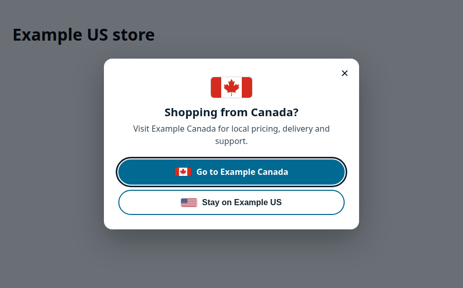

# Shopify Geo Store Suggestion

**Lead Developer:** Nícolas Cartín Reyes
**License:** MIT

A consent-aware, accessible replacement for IP auto-redirect scripts on multi-store Shopify setups. Instead of sending visitors to another storefront without asking, the snippet suggests the matching regional store in a centered dialog and lets the visitor decide.

This repository is intentionally store-neutral. It contains no merchant name, store domain, theme ID, credentials, customer data or production validation records. It is a generalized version of a production implementation; the earlier redirect-based approach is in [geo-fencing](https://github.com/NikoCartin/geo-fencing).

## What it does

- **No third-party IP lookup.** Detects the visitor's country with Shopify's same-origin `/browsing_context_suggestions.json`, the endpoint Shopify's own geolocation features use.
- **Suggests, never redirects.** A centered dialog offers "Go to Example Canada" or "Stay on Example US". Crawlers, `navigator.webdriver`, the theme editor, admin and checkout are skipped.
- **Deep links safely.** Links to the same product, collection or page on the target store only when it exists there, checked through Shopify's public `.js` / `.json` endpoints. Otherwise it links to the target home page, avoiding 404s when handles differ between stores.
- **Respects consent.** The visitor's choice is kept for 14 days in `localStorage` only when preferences consent is granted (OneTrust Functional `C0003` or Shopify Customer Privacy `preferencesProcessingAllowed()`). Without consent it lasts for the session only. No cookies are set, and storage re-syncs when consent changes.
- **Does not stack popups.** Waits until the cookie banner is answered and can pause promotional popups while open.
- **Accessible.** `role="dialog"`, `aria-modal`, labelled title and description, focus trap, Escape and backdrop dismissal, scroll lock, 4.5:1 contrast and decorative flags hidden from assistive technology.
- **Footer region links** with `hreflang` attributes as a permanent, always-available selector.

## Installation

1. Copy `snippets/geo-store-suggest.liquid` and `snippets/footer-region-links.liquid` into your theme.
2. Edit the configuration block at the top of the `geo-store-suggest` script: `STORES`, `COUNTRY_TO_STORE`, `PAUSE_SELECTORS` and, if needed, the default store key for `myshopify.com` and preview domains.
3. Edit the `regions` list and `hreflang` values in `footer-region-links.liquid`.
4. Render the snippets (see [examples/theme-integration.md](examples/theme-integration.md)) and remove any previous redirect script.
5. Install the same snippets on every regional store with that store's entry as the current store.

## QA

- `?geo_test=CA` simulates a visitor from Canada (use any configured country code).
- `?geo_reset=1` clears the stored choice.
- `?region=chosen` is added to every outbound link so the destination store records the choice and does not suggest switching back. It is removed from the address bar on arrival.

See [docs/qa-checklist.md](docs/qa-checklist.md) and [docs/design-decisions.md](docs/design-decisions.md).

## Limitations

- Country detection depends on Shopify's endpoint and the visitor's IP; VPNs can return another country.
- Deep-link checks cover products, collections and pages. Other paths link to the home page.
- The snippet does not add page-level `hreflang` tags. Add them separately for search engines.
- Passing the automated checks is not a legal accessibility or privacy certification.
